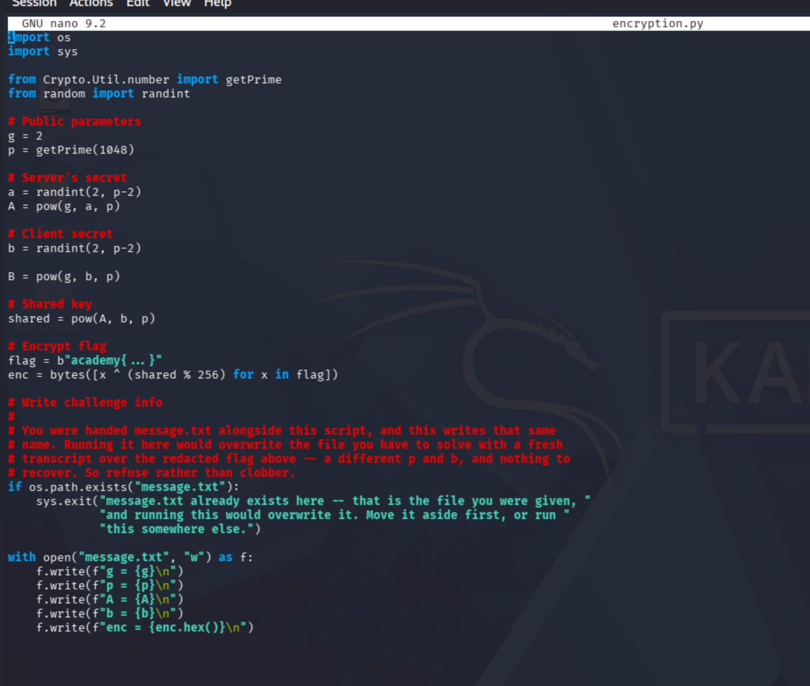

# Leaked Diffie-Hellman Secret

**CTF / Cryptography / Medio / 14 de octubre de 2026**

## Resumen

El desafío involucra un sistema de cifrado donde un mensaje fue protegido utilizando una clave compartida derivada del algoritmo de intercambio Diffie-Hellman, seguida de un cifrado XOR simétrico. El objetivo fue aprovechar la filtración accidental de una clave privada para recalcular el secreto compartido y descifrar el mensaje original.

## Reconocimiento

Al analizar los archivos proporcionados (`source.py` y `message.txt`), identifiqué la estructura del algoritmo de Diffie-Hellman:

- Se utilizan los parámetros públicos `p` (módulo primo) y `g` (base).
- El servidor genera un secreto `a` y publica `A`.
- El cliente genera un secreto `b` y publica `B`.
- El secreto compartido se calcula matemáticamente como $A^b \pmod p$ o $B^a \pmod p$.



Al revisar el contenido de `message.txt`, noté que el script guardó por error la variable `b` (el secreto privado del cliente) junto con la variable pública del servidor `A` y el texto cifrado `enc`.

## Proceso de resolución

Con el secreto privado del cliente ($b$) expuesto, la seguridad de todo el intercambio colapsa. Desarrollé un script en Python (`solver.py`) para replicar el último paso del algoritmo:

1. **Extracción de datos:** Extraje los valores masivos de `p`, `A` y el secreto filtrado `b` del archivo de texto.
2. **Reconstrucción de la clave:** Recalculé la clave compartida utilizando la función de potenciación modular eficiente de Python: `shared = pow(A, b, p)`.
3. **Inversión del cifrado:** Sabiendo que el cifrado final se realizó iterando una operación XOR entre el texto plano y la llave derivada (`shared % 256`), apliqué la operación matemática inversa. Dado que el operador XOR es simétrico ($A \oplus B \oplus B = A$), aplicar la misma llave sobre el ciphertext revierte los bytes a su estado original.

## Solución

Escribí y ejecuté el siguiente script de desencriptación en Python:

```python
p = 2188545828481232917915233525806579818209760678972220490921380750542193455665345717562182558864409541451041964360901352616297280654258287473010375935406137903689564954762347824228761657501247248979653142698163854882116855521952627898416433209318642163322021284188040749653581645061299781147685165607754045402815547537
A = 529022054504968019469968111961692103333962097204384321062327406113469798583084528471911087369430603184315616289885944538403549216006196112599856159910375335838601931262259012757936708816266131815368447196183194865289491972488369456495842428832190461512811822688595599282473173695956797450916384282506132120013828366
b = 806108241018714272971792803761488787583500782708354296181179175643414634637904065955198182937625129233790050616136051643206357851994861572647233251265904450054206496643678855386739080010799844605476667118318730605723614207809884834764849344555331442139243115610235608110485560140584263429781350962431123512110941522 

# Recalcular secreto compartido
shared = pow(A, b, p)

# Cifrado en hex a bytes
enc_bytes = bytes.fromhex('b7b5b7b2b3bbafadb2be89a5e5b5a4e5a289b3e5efe3e2b4b3b4ab')

# Operación XOR inversa
decrypted = bytes([x ^ (shared % 256) for x in enc_bytes])
print(decrypted.decode('utf-8'))

**Flag:** `academy{dh_s3cr3t_e3954beb}`

## Qué aprendí

- **Teoría de Diffie-Hellman:** Reafirmé cómo las claves públicas (`A` y `B`) viajan por la red de forma segura basándose en la dificultad de resolver el problema del logaritmo discreto, mientras que los secretos (`a` y `b`) jamás deben salir de la máquina local.

- **Auditoría de código y gestión de secretos:** El cifrado puede ser matemáticamente irrompible, pero una mala implementación humana (como registrar claves privadas en logs o archivos de salida) destruye por completo el modelo de seguridad.