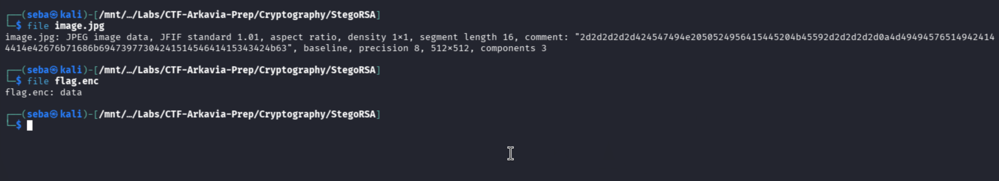
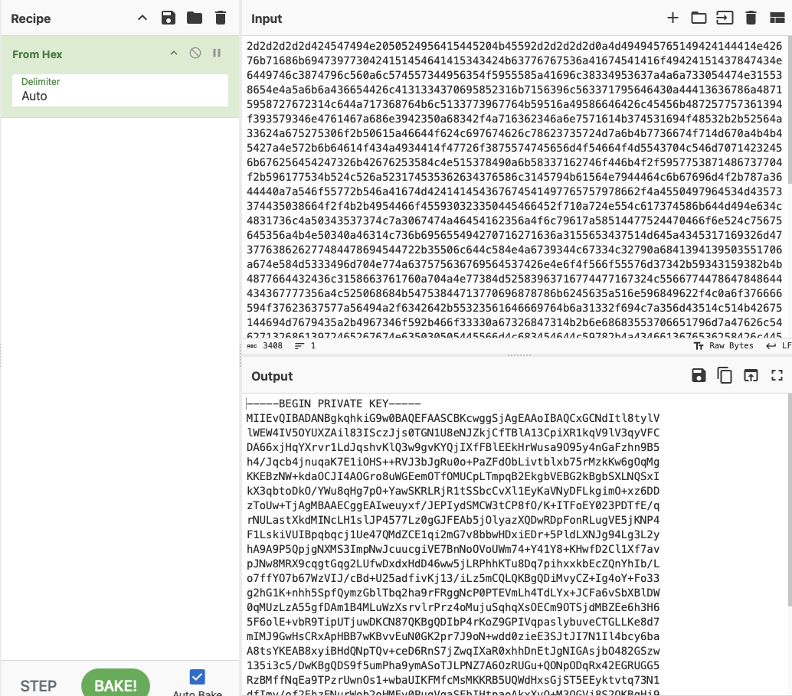
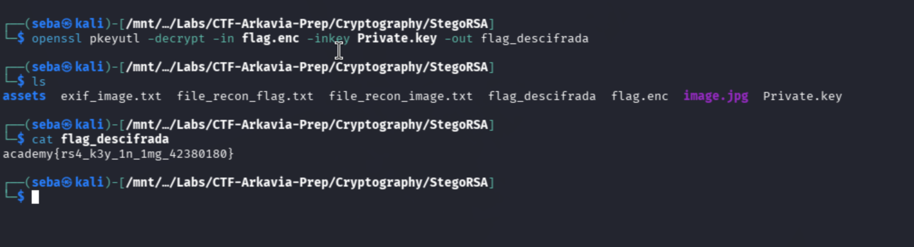

# StegoRSA
**PicoCTF / Cryptography - Forensics / Medio / 12 de octubre de 2026**

## Resumen
El reto entregó un archivo cifrado (`flag.enc`) y una imagen. El objetivo fue realizar un análisis esteganográfico a la imagen para recuperar una llave privada RSA oculta en los metadatos y utilizarla para desencriptar el mensaje final.

## Reconocimiento
Inicié el análisis verificando la naturaleza de los archivos descargados:
- Ejecuté `file` contra ambos archivos. `flag.enc` resultó ser data cruda (binario cifrado), mientras que `image.jpg` era una imagen JPEG válida.

- Procedí con un análisis de metadatos utilizando `exiftool image.jpg`.
- Dentro de la salida, identifiqué un campo `Comment` inusualmente largo compuesto por una extensa cadena de caracteres hexadecimales (`2d2d2d...`).

## Proceso de resolución
1. **Extracción de la llave:** Reconociendo que `2d` en hexadecimal corresponde al guion `-`, sospeché que la cadena ocultaba un certificado o llave en formato PEM (que usualmente comienza con `-----BEGIN...`).
2. Copié el bloque hexadecimal y utilicé **CyberChef** con la receta **"From Hex"**.
3. El resultado fue, efectivamente, una llave privada RSA válida.

4. Guardé este texto decodificado en mi máquina Kali como `private.key`.
5. **Desencriptación:** Con el archivo cifrado y la llave privada en mi poder, utilicé `openssl` para descifrar el mensaje:
   `openssl pkeyutl -decrypt -in flag.enc -inkey private.key -out flag.txt`

## Solución
Al leer el archivo resultante de OpenSSL o el output en consola, obtuve el mensaje original en texto claro.

- **Flag:** academy{rs4_k3y_1mg_42380180}

## Qué aprendí
- **Metadatos como vector de esteganografía:** Herramientas como `exiftool` son fundamentales en la fase de reconocimiento; los comentarios EXIF son un escondite muy común.
- **Identificación visual de Hexadecimal:** Reconocer patrones como `2d2d2d` como el inicio de un bloque PEM ahorra mucho tiempo en competencias.
- **Manejo de OpenSSL:** Sintaxis básica de criptografía asimétrica en la terminal para desencriptar archivos usando llaves privadas con `pkeyutl` o `rsautl`.